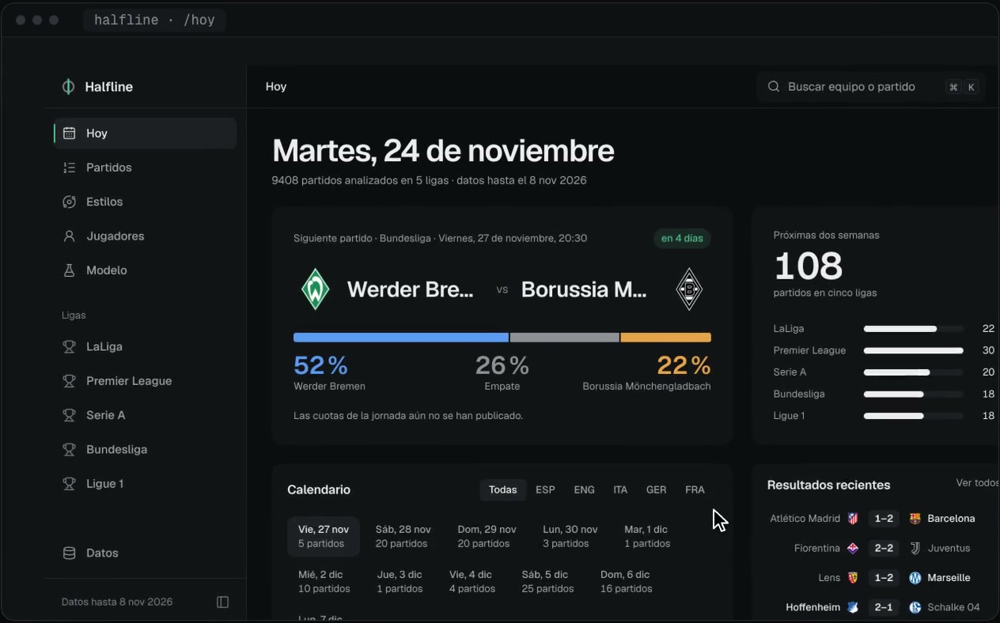

<p align="center">
  
</p>

<h1 align="center">Halfline</h1>

<p align="center">
  1X2 probabilities for Europe’s top five football leagues, compared with bookmakers and Polymarket.
</p>

<p align="center">
  
  
  
  <a href="https://github.com/MrJuandi/halfline/actions/workflows/tests.yml"></a>
</p>

<p align="center">
  
</p>

<p align="center"><a href="https://juandiegodiaz.vercel.app/work/halfline">Case study and demo</a></p>

---

Before each match, Halfline estimates the probability of a home win, a draw and an away win. It removes the margin from the odds to get the probability implied by the market, and compares it with its own models: xG-adjusted Elo, Dixon-Coles and meta-models. Everything is evaluated out of sample.

The app interface and the technical notes in `docs/` are in Spanish.

## Features

- **Matchday:** upcoming matches with the model's probability next to the margin-free market probability.
- **Match sheet:** shot map with xG, xG race, momentum, line-ups, heat maps and advanced statistics.
- **Leagues and teams:** table with expected goals (xG) and expected points (xPts), recent form, Elo and underlying performance.
- **Players and styles:** role profiles with per-90 percentiles, similar players and a playing-style map.
- **Model evaluation:** log-loss, Brier and RPS by league, calibration and simulated returns with confidence intervals.
- **Markets:** each bookmaker's margin, market biases and a comparison with Polymarket.

## Results

Out-of-sample test: 2025/26 and 2026/27 seasons, 2,049 matches. Lower is better.

| Model | Log-loss |
|---|---|
| Closing market (margin removed) | 0.975 |
| Pre-closing market (margin removed) | 0.976 |
| xG-adjusted Elo | 0.993 |
| Historical frequencies | 1.071 |

The market is still ahead of the models. Details are in [`docs/modelos.md`](docs/modelos.md) and [`docs/sesgos_mercado.md`](docs/sesgos_mercado.md) (Spanish).

## Architecture

```
futdata/             Ingestion, cleaning, features, models and API
├── football_data    Results and closing odds
├── espn             Statistics, line-ups and fixtures
├── understat        xG per match
├── pitchapi         Shots with coordinates, momentum and heat maps
├── transfermarkt    Squad market values
├── polymarket       Prediction-market prices
├── features         Pre-match features, without information leakage
├── models/          Elo, goals, margin removal, evaluation and biases
└── api              Read-only Flask API
web/                 React + TypeScript + Vite frontend
tests/               pytest tests
docs/                Technical notes on data, models and design
```

## Getting started

Requirements: Python 3.12 or later and Node 22 or later.

```bash
pip install -r requirements.txt
npm install --prefix web
```

Data (not versioned):

```bash
python -m futdata download          # raw sources: football_data, espn, understat, transfermarkt, pitchapi
python -m futdata.polymarket        # Polymarket prices
python -m futdata.features          # feature table
python -m futdata.models.evaluate   # training and evaluation
```

PitchAPI needs a key in `.env`:

```bash
PITCHAPI_KEY=your_key
```

Development:

```bash
./scripts/dev.sh                    # API on :8000 and web on http://localhost:5173
```

Tests:

```bash
python -m pytest
```

## API

| Endpoint | Description |
|---|---|
| `GET /api/meta` | Data coverage and date |
| `GET /api/upcoming?days=` | Upcoming matches with probabilities |
| `GET /api/matches?league=&season=&team=&limit=` | Played matches |
| `GET /api/matches/<match_id>` | Full match sheet |
| `GET /api/leagues/<league>/table?season=` | Table with xG and xPts |
| `GET /api/teams/<league>/<team>?season=` | Team page |
| `GET /api/teams` | Available teams |

## Stack

Python · pandas · NumPy · SciPy · scikit-learn · Flask · React · TypeScript · Vite · Tailwind CSS · d3 · Motion
